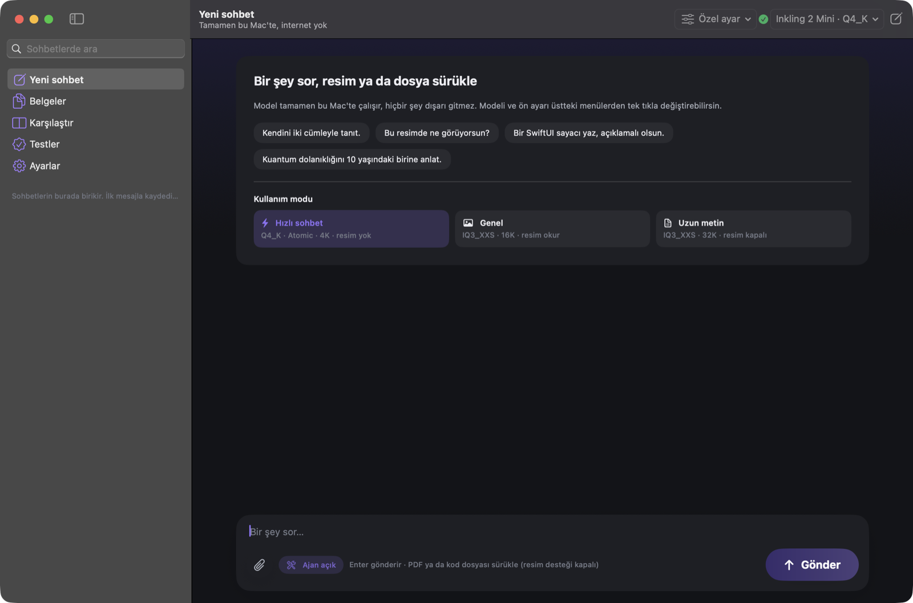
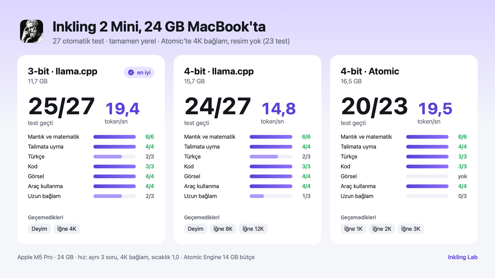

<p align="center"></p>

<h1 align="center">Inkling Lab</h1>

<p align="center">
A native macOS app for running local GGUF models on Apple Silicon: chat, documents, a tool-using agent and a built-in benchmark suite.<br>
Everything runs on your Mac. Nothing leaves it.
</p>

<p align="center">
<a href="#türkçe">Türkçe</a> · <a href="#quick-start">Quick start</a> · <a href="#benchmarks">Benchmarks</a> · <a href="CONTRIBUTING.md">Contributing</a>
</p>

<p align="center"></p>

## Why

I wanted to know how far a 24 GB MacBook can go with a modern MoE model ([Inkling 2 Mini](https://huggingface.co/thinkingmachines)), and I wanted one app to use it every day instead of a terminal. Inkling Lab is built with SwiftUI and drives [llama.cpp](https://github.com/ggml-org/llama.cpp) and [Atomic Engine](https://github.com/AtomicBot-ai/atomic-engine) in the background. It works with any GGUF model, not just Inkling.

## Features

- **One-click modes.** *Fast chat* (Atomic Engine, 4K), *General* (16K, reads images), *Long text* (32K). The app picks the right model, context size and engine, and switches without restarting.
- **Model menu.** Finds every `.gguf` in `~/models` (and folders you add), shows the size and a warning for models that are too heavy for your RAM, and loads or unloads with one click. If an `mmproj` file sits next to the model, image input turns on automatically.
- **Documents.** Drop a folder or PDFs. *Summarize all* splits long files into chunks that fit the context, summarizes them and merges the results. *Ask* finds the most relevant chunks (BM25) and answers with `[1]`-style citations you can open.
- **Agent mode.** The model gets a calculator, the date and time, and list, read, write and shell tools inside a working folder you choose. Writing a file or running a command always asks you first and shows exactly what will happen. Paths outside the folder are rejected. It can also open your installed Claude Code skills (`~/.claude/skills`) and follow their instructions, and talk to an optional local notes server. Broken tool calls from local models (code fences, trailing commas, calls left in plain text, missing arguments) are repaired or sent back to the model with a clear error.
- **Chat.** Streaming, a collapsible reasoning panel, tokens per second for every answer, images (drag, paste or pick), file attachments, code blocks with copy, and history with search, pinning and Markdown export.
- **Benchmarks.** 35 automatic tests across reasoning, instructions, Turkish, code, vision, tool calls, multi-step agent tasks and long context. The 8 agent tests run the real tools in a temporary folder and check the files the model leaves behind. Results are saved, and you can export a shareable 1600×900 result card.
- **Presets and sampling.** Temperature, top-p, min-p, top-k, max tokens and system prompt. The app remembers the last preset per model.
- **Themes.** System, light and dark, with five accent colors.

> The interface is currently in Turkish. An English localization is the most wanted contribution, see [issues](../../issues).

## Quick start

Requirements: macOS 15+, Apple Silicon, Xcode 16 or the Swift 6 toolchain.

```bash
# 1. llama.cpp (the default engine)
git clone https://github.com/ggml-org/llama.cpp ~/llama.cpp
cmake -S ~/llama.cpp -B ~/llama.cpp/build -DGGML_METAL=ON && cmake --build ~/llama.cpp/build -j --target llama-server

# 2. A model in ~/models (any GGUF works), for example Inkling 2 Mini from Unsloth:
#    ~/models/inkling-2-mini/Inkling-2-Mini-UD-IQ3_XXS.gguf  (+ mmproj-F16.gguf for images)

# 3. The app
git clone https://github.com/burakbuildsofficial/inkling-lab && cd inkling-lab
./scripts/build-app.sh && open build/InklingLab.app
```

The app starts `llama-server` on `127.0.0.1:8001` and stops it when you quit. You can change the paths under Settings › Server.

### Optional: Atomic Engine (faster 4-bit, less memory)

Atomic Engine streams MoE experts from the SSD, so a 4-bit model runs within a fixed memory budget. When you pick a model whose name contains `-AD-`, Inkling Lab uses it automatically.

```bash
git clone -b engine-development https://github.com/AtomicBot-ai/atomic-engine ~/atomic-engine
cmake -S ~/atomic-engine -B ~/atomic-engine/build-metal -DGGML_METAL=ON -DLLAMA_BUILD_UI=OFF -DLLAMA_USE_PREBUILT_UI=OFF
cmake --build ~/atomic-engine/build-metal -j --target llama-server
# Model + DSpark draft in one folder, for example ~/models/inkling-2-mini/atomic/
#   Inkling-2-Mini-AD-Q4_K.gguf, dspark-Inkling-2-Mini-Q8_0.gguf
```

Limits in budget mode: 4K context, no image input, and only AD-quantized files.

## Benchmarks

<p align="center"></p>

MacBook Pro M5 Pro, 24 GB. The same 3 prompts, 4K context, 512 tokens ([raw log](docs/benchmarks/speed-4k.txt)).

| Setup | Temp 0 | Temp 1.0 | Process memory | Tests |
|---|---|---|---|---|
| llama.cpp · IQ3_XXS (3-bit) | 20.5 tok/s | 19.4 tok/s | 11.1 GB | 25/27 |
| llama.cpp · IQ4_XS (4-bit) | 15.0 tok/s | 14.8 tok/s | 14.0 GB | 24/27 |
| Atomic Engine · AD-Q4_K (4-bit) + DSpark | 22.6 tok/s | 19.5 tok/s | 8.9 GB | 20/23* |

\* Atomic runs without image input, so the 4 vision tests are skipped. Its 3 failures are the needle-in-a-haystack tests: the test text says "don't share this with anyone" and the model obeys, and at 3K the 4K context runs out. That is a test-design bug, and fixing it is a [good first issue](../../issues).

32K context with IQ3_XXS fits in 11.4 GB and found a number hidden in the middle of a 30K-token text. Reading it took about 6 minutes (85 tok/s prompt processing).

### Inkling 2 Mini vs Bonsai 2.5 27B

Same machine, 16K context, llama.cpp, each model with its recommended sampling (Bonsai: temp 1.0, top-p 0.95, top-k 20, at least 12,288 output tokens). 31 tests: the vision tests were skipped for both. Raw logs: [Inkling](docs/benchmarks/suite-31-IQ3_XXS-16k.txt), [Bonsai](docs/benchmarks/suite-31-Bonsai-2.5-Q2_0-16k.txt).

| Model | File | Passed | Agent (8) | Total time | Agent time | Speed |
|---|---|---|---|---|---|---|
| Inkling 2 Mini · UD-IQ3_XXS | 11.7 GB | 30/31 | 8/8 | 27.2 min | 9.8 min | 13.6–21.2 tok/s |
| [Bonsai 2.5 27B](https://huggingface.co/prism-ml/Ternary-Bonsai-2.5-27B-GGUF) · Q2_0 | 7.67 GB | 28/31 | 8/8 | 14.3 min | 4.1 min | 18.1–24.4 tok/s |

Bonsai's misses: one JSON answer (`"plaka": 06`, a leading zero is not valid JSON) and two Turkish questions. Inkling's only miss was the same Turkish idiom. Bonsai is faster mainly because it thinks less, not because it decodes much faster.

Run the suite yourself, headless:

```bash
build/InklingLab.app/Contents/MacOS/InklingLab --run-tests --model ~/models/…/model.gguf
# only the agent tests, with a built-in preset and a bigger output budget for long thinkers:
build/InklingLab.app/Contents/MacOS/InklingLab --run-tests --only agent --preset Bonsai --min-tokens 12288 --model …
```

Please share your numbers (chip, RAM, model, tok/s) in [Discussions](../../discussions) or open a PR that adds them to `docs/benchmarks/`.

## Project layout

```
Sources/InklingLab/
  App.swift                    window, menus, shortcuts
  Design/                      theme tokens, motion
  Model/                       chat, presets, test suite
  Services/ServerManager       llama-server / Atomic process, one-click switching
  Services/LLMClient           OpenAI-compatible streaming client
  Services/DocumentWorkspace   chunking, map-reduce summaries, BM25 retrieval
  Services/AgentTools          agent tools and the folder sandbox
  Services/TestRunner          benchmark runner
  Views/                       chat, documents, tests, settings, sidebar
scripts/                       build-app.sh, result-card.swift, make-icon.swift
```

## Contributing

PRs are very welcome, including small ones. See [CONTRIBUTING.md](CONTRIBUTING.md) and the issues labeled `good first issue`.

## License

[MIT](LICENSE). Model weights and the engines have their own licenses.

---

## Türkçe

Apple Silicon Mac'te yerel GGUF modellerini çalıştırmak için yerli bir macOS uygulaması. Sohbet, belge asistanı, araç kullanan ajan ve hazır test takımı içerir, her şey bu Mac'te kalır.

- **Tek tık modlar:** Hızlı sohbet (Atomic, 4K), Genel (16K, resim), Uzun metin (32K)
- **Belgeler:** klasör ya da PDF sürükle, hepsini özetle ya da soru sor; cevaplar `[1]` kaynaklı gelir
- **Ajan:** hesap makinesi, saat, seçtiğin klasörde dosya okuma/yazma ve terminal; yazma ve komut her seferinde onay ister. Kurulu Claude Code becerilerini okuyabilir; bozuk araç çağrılarını onarır
- **Testler:** 35 otomatik test (8'i çok adımlı ajan testi) ve paylaşılabilir sonuç kartı
- **Karşılaştırma:** aynı 31 testte Inkling 2 Mini IQ3_XXS 30/31 (27,2 dk), Bonsai 2.5 27B Q2_0 28/31 (14,3 dk); ikisi de ajan testlerinde 8/8

Kurulum için yukarıdaki *Quick start* bölümüne bak. Katkılar Türkçe ya da İngilizce olabilir.
